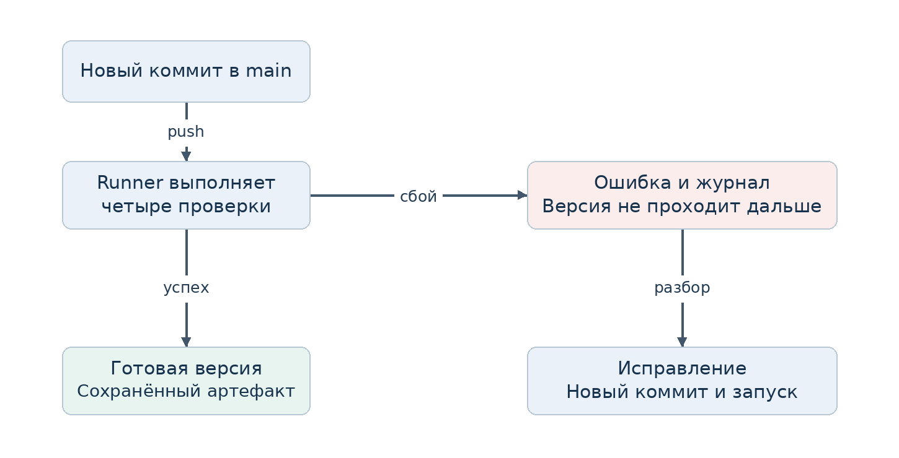
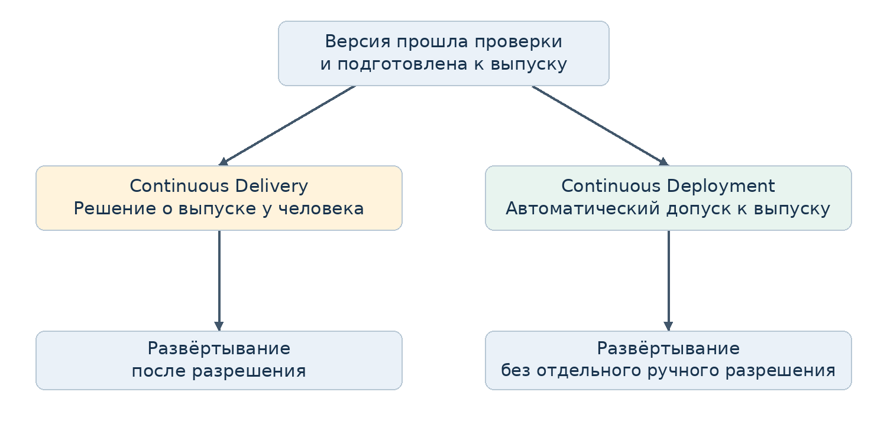
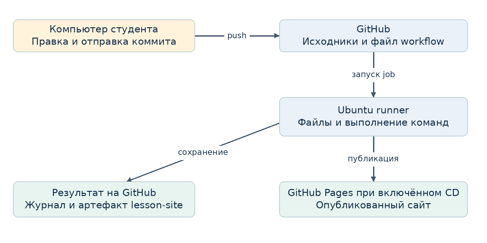
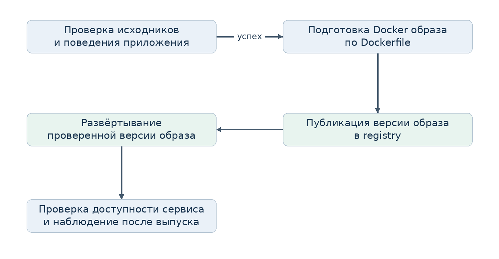

# Занятие по CI CD с нуля

Конспект преподавателя третьего курса СПО
90 минут • DevOps и связь с тестированием • GitHub Actions

Это первое занятие о том, как изменение превращается в проверенную версию и затем попадает к пользователю. Студенты работают с готовой страницей расписания. Разрабатывать приложение и писать тесты на этой паре не требуется. Изучаем автоматизацию проверки, чтение результата и правило допуска к публикации.

## Результат занятия
К концу пары студент объясняет различие CI, Continuous Delivery и Continuous Deployment; находит событие, runner и команду проверки в workflow; получает красный и зелёный запуск; связывает результат с конкретным коммитом; объясняет, почему зелёный запуск не гарантирует отсутствие дефектов.

## Что открыть перед парой
Конспект; свой отдельный публичный учебный репозиторий с проектом из папки demo; вкладку Actions; страницу site/index.html; архив материалов для раздачи. Для показа CD заранее включите GitHub Pages и выполните пробный запуск по инструкции на странице 11. Студентам достаточно браузера и аккаунта GitHub. Локальный Python нужен только для резервного показа.

## Ход пары
- 0–7 минут — проблема ручного выпуска и обсуждение ошибок.
- 7–20 минут — CI, Delivery и Deployment, схемы 1 и 2.
- 20–30 минут — runner, workflow и чтение YAML, схема 3.
- 30–48 минут — демонстрация успешного запуска, поломки и исправления.
- 48–72 минуты — самостоятельная практика по STUDENT_TASK.md.
- 72–82 минуты — показ публикации преподавателем и обсуждение CD.
- 82–90 минут — короткая защита и проверка понимания.

## Как читать конспект
Абзацы «Сказать» можно использовать как речь. Блоки «Спросить» и «Ожидаемый ответ» задают диалог. Команды и действия проверяются на готовом проекте. Страницы 7 и 11 относятся к подготовке преподавателя; их не нужно читать студентам. Если доступно только 45 минут, проведите теорию, один цикл ошибки и исправления, а практику и CD перенесите на следующую встречу.

---

# От ручного выпуска к автоматической проверке

0–7 минут

## Начать с ситуации
Сказать: «Представьте страницу расписания колледжа. Нужно поменять аудиторию. Само изменение занимает минуту. Но после него надо убедиться, что страница открывается, заголовок на месте, оформление подключено и опубликована именно новая версия. Если всё делать вручную, человек каждый раз вспоминает последовательность действий».

Спросить: «Какая ошибка здесь может возникнуть, даже если человек правильно поменял номер аудитории?»

Ожидаемые ответы: загрузил старый файл; забыл проверить; потерял файл стилей; обновил свою копию, а сайт остался прежним; проверил одну версию, опубликовал другую. Если студенты молчат, предложите два варианта: «Проверили страницу на своём компьютере. Доказывает ли это, что на сайте та же версия?»

## Разобрать ручной процесс
На доске перечислите действия: получить изменение; проверить; подготовить комплект файлов; опубликовать; убедиться, что новая версия доступна. Подчеркните места, где человек должен что-то вспомнить или выполнить повторно.

Сказать: «Проблема не в том, что люди недостаточно внимательны. У нас повторяемая последовательность, и её результат должен быть виден команде. Мы опишем её в репозитории и поручим выполнение системе. Тогда для каждого изменения останется запись: что запускалось, что прошло, на чём остановились».

## Связать с известным
Сказать: «Git уже хранит версии. Linux позволяет запускать команды. Тесты умеют сравнивать ожидаемое с фактическим. Сегодня мы соединим эти инструменты: после изменения репозитория команды проверки будут запускаться автоматически на другой машине».

Спросить: «Если автоматизировать неправильную проверку, станет ли результат достовернее?»
Ожидаемый ответ: выполнение станет регулярным, но сама проверка лучше от этого не станет. Качество проверок остаётся отдельной задачей.

## Зафиксировать учебную задачу
Сказать: «Нам нужно не просто увидеть зелёный значок. Мы должны уметь объяснить, какое изменение проверили, где выполнялась проверка, почему получился такой результат и что система сделала после него».

---

# Непрерывная интеграция

7–13 минут • Схема 1

Сказать: «Интеграция означает соединение изменений с общей версией проекта. Если каждый долго работает отдельно, проблемы совместимости обнаруживаются поздно. Практика CI предполагает небольшие частые изменения, их регулярное объединение и автоматическую проверку» [1].

CI — Continuous Integration, непрерывная интеграция. В нашем занятии мы наблюдаем её механизм обратной связи: изменение в общей ветке запускает проверки и подготовку версии. В работе команды одного YAML-файла недостаточно: люди должны регулярно объединять изменения и разбирать ошибки, а не оставлять сломанный процесс без внимания.



## Как объяснить схему
Сказать: «После изменения срабатывает событие. Система получает нужную версию и выполняет проверки. Если проверка завершается ошибкой, новая версия не проходит дальше по настроенному пути. Исправление — это новый коммит и новый запуск. Так мы получаем быструю обратную связь для каждого небольшого изменения».

Спросить: «Почему плохо вносить сразу двадцать разных изменений перед первой проверкой?»
Ожидаемый ответ: при ошибке сложнее найти причину; больше вариантов, что сломалось; труднее отделить полезное изменение от проблемного.

## Что значит непрерывная
Это регулярная проверка изменений по событию, а не обязательная работа тестов каждую секунду. В нашем workflow событие — push в main или pull request в main. Локальное сохранение файла без коммита и отправки не запускает GitHub Actions.

## Методическая оговорка
Наш пример использует одну общую ветку и демонстрирует автоматические проверки. Практику командной интеграции через ветку и pull request можно добавить следующим шагом. Не называйте наличие Actions достаточным доказательством того, что команда уже выстроила CI.

---

# Два значения CD

13–20 минут • Схема 2

Сказать: «После успешной проверки есть следующий вопрос: как сделать версию доступной пользователю? Здесь встречаются два выражения с одинаковым сокращением CD» [2].

Continuous Delivery — непрерывная поставка. Процесс поддерживает версию в состоянии готовности к выпуску. Проверки и подготовка автоматизированы; решение о выпуске в рабочую среду может принимать человек. Это не просто отправка ZIP по почте: путь к выпуску должен быть определён и воспроизводим.

Continuous Deployment — непрерывное развёртывание. Изменение, прошедшее предусмотренные проверки, автоматически попадает в рабочую среду без отдельного ручного решения о каждом выпуске.



## Попросить классифицировать
Ситуация А: «Тесты прошли, версия подготовлена, ответственный разрешает выпуск». Ожидаемый ответ: Continuous Delivery с ручным допуском к выпуску.
Ситуация Б: «Изменение прошло проверки и автоматически появилось на публичном сайте». Ответ: Continuous Deployment.
Ситуация В: «Мы только запустили тесты и скачали архив». Ответ: показан CI с подготовкой артефакта; развёртывание ещё не показано. Одного архива недостаточно, чтобы утверждать, что весь процесс поставки настроен.

## Среды
Среда проверки нужна для выполнения проверок. Тестовая среда может предоставлять работающий сервис для проверки взаимодействий. Рабочая среда, production, обслуживает пользователей. В примере runner выполняет проверки, а GitHub Pages предоставляет опубликованный учебный сайт. Публикация в тестовой среде сама по себе ещё не означает автоматического выпуска в production.

## Контрольный вопрос
Спросить: «Если на действующем сайте версия 1, а проверка версии 2 упала, исчезнет ли версия 1?»
Ожидаемый ответ: в нашем процессе нет — публикация версии 2 не выполняется, предыдущий опубликованный сайт остаётся. Это свойство данного workflow, а не гарантия любого процесса, который называют CI/CD.

---

# Где выполняются команды

20–25 минут • Схема 3

Сказать: «Файл настроек хранится в GitHub, но команды должен выполнять конкретный компьютер. Такой исполнитель называется runner. В нашем случае это предоставляемая GitHub Linux-машина с Ubuntu. Она получает файлы проекта и запускает Python. Ваш ноутбук при этом не становится сервером тестирования» [3].



## Минимальный словарь
- Pipeline — конвейер обработки изменения. Здесь: проверка, подготовка файлов и при включённом CD публикация.
- Workflow — файл сценария GitHub Actions. Один файл может содержать несколько jobs.
- Event — событие запуска. Push отправляет изменения; pull request предлагает их объединить; workflow_dispatch разрешает ручной запуск.
- Job — группа шагов, выполняемая на runner. Разные jobs могут работать независимо; порядок между ними задают зависимостями.
- Step — отдельный шаг внутри job. Обычные шаги выполняются последовательно.
- Action — готовая переиспользуемая операция, например получение репозитория.
- Artifact — сохранённый результат запуска: в примере комплект файлов сайта.
- Log — журнал, в котором видны выполненные команды и их вывод.
- Deploy — размещение подготовленной версии в целевой среде.

## Привязать термины к примеру
Спросить: «Что здесь событие, что исполнитель, а что результат?»
Ожидаемый ответ: push в main; Ubuntu runner; результаты четырёх тестов и артефакт lesson-site. При подключённом CD появляется также новая версия сайта.

Сказать: «Артефакт сохраняют отдельно от рабочего каталога runner. Благодаря этому результат можно скачать после завершения job. Временные файлы на машине исполнения сами по себе не превращаются в опубликованный сайт» [4].

---

# Чтение первого workflow

25–30 минут • Открыть .github/workflows/ci.yml

Сказать: «YAML описывает, когда запускать работу, где её выполнять и какие шаги сделать. Отступы показывают вложенность. Названия name помогают читать журнал. Строка uses вызывает готовое действие, run запускает команду» [5].

```yaml
name: Lesson CI
on:
  push:
    branches: [main]
  pull_request:
    branches: [main]
  workflow_dispatch:
permissions:
  contents: read
jobs:
  check-build:
    runs-on: ubuntu-latest
    steps:
      - name: Get repository
        uses: actions/checkout@v7
      - name: Prepare Python
        uses: actions/setup-python@v7
        with:
          python-version: '3.12'
      - name: Run tests
        run: python -m unittest discover -s tests -v
      - name: Build site
        run: python build.py
      - name: Save site artifact
        uses: actions/upload-artifact@v7
        with:
          name: lesson-site
          path: dist/
          if-no-files-found: error
          retention-days: 3
```

Покажите три опоры: on — событие; runs-on — исполнитель; run — команда. Checkout получает файлы нужной версии. Setup Python выбирает Python 3.12. Тесты идут перед сборкой. Сборка копирует сайт в dist и записывает коммит в release.json. Последний шаг сохраняет dist как артефакт [6–8].

Спросить: «Какая строка заставляет тесты запускаться? Что изменится, если её удалить?» Ответ: run с unittest; автоматической проверки этим набором тестов больше не будет. Статус workflow сам по себе не доказывает, что тесты вообще выполнялись.

---

# Подготовка преподавателя

Выполнить до занятия • Обычно 20–30 минут при работающем доступе

## Проверить исходники
Распакуйте архив. В demo находятся site/index.html, site/style.css, tests/test_site.py, build.py и .github/workflows/ci.yml. Проект не требует сторонних Python-пакетов. Тесты подготовлены заранее; студентам не нужно разбирать их реализацию, чтобы исследовать процесс.

Откройте терминал в demo и выполните:
```bash
python -m unittest discover -s tests -v
python build.py
```
Ожидается: четыре теста с результатом OK; каталог dist с index.html, style.css и release.json. Локально в release.json будет source_commit: local. В Windows вместо python может требоваться py -3, в Linux/macOS — python3. В workflow оставьте python.

## Создать учебный репозиторий
1. GitHub → New repository. Имя cicd-first-run-teacher, видимость Public, добавить README. Проверьте, что основная ветка называется main.
2. Через Add file → Upload files загрузите site, tests и build.py в корень с сохранением путей. Не загружайте сам ZIP и не создавайте лишний уровень demo в репозитории. Если папки не принимаются, создайте файлы по полным путям через Add file → Create new file.
3. Через Add file → Create new file создайте .github/workflows/ci.yml и вставьте весь workflow_templates/ci.yml.txt. Сохраните коммит в main. Этот способ помогает не потерять скрытую папку .github при загрузке.
4. Откройте Actions → Lesson CI → запуск → check-build. Дождитесь четырёх успешных тестов, сборки и артефакта lesson-site.
5. Скачайте артефакт, распакуйте и откройте index.html. Сверьте source_commit из release.json с коммитом запуска.

## Подготовить показ CD
Используйте отдельный репозиторий преподавателя. Включите Pages и замените workflow по странице 11, получите доступную страницу. Для начала пары можно оставить готовый CI/CD: при разборе CI показывайте только check-build, а deploy раскройте позже. Студенты на практике используют CI без Pages.

## Проверка готовности
До пары один раз получите красный запуск и исправленный зелёный, проверьте доступность Actions у студентов. Сохраните открытыми успешный и ошибочный запуски. В архиве есть локальные резервные журналы. Удалённый запуск и публикация в вашем аккаунте требуют этой предварительной проверки; локальный прогон не проверяет настройки аккаунта GitHub.

---

# Демонстрация успешного запуска

30–38 минут • Преподаватель показывает экран

## Сначала показать объект проверки
Откройте site/index.html и исходную страницу. Сказать: «Это уже готовый проект. У нас есть файлы сайта, четыре автоматические проверки и инструкция выполнения. Сегодня нас интересует путь версии, а не написание HTML или Python».

Назовите требования четырёх проверок: заголовок вкладки равен «Расписание DevOps»; на странице один h1 с таким же текстом; подключённый CSS-файл существует; строка темы «Тема занятия: CI/CD» присутствует. Уточните: это небольшой демонстрационный набор, а не полная проверка сайта.

## Создать понятное изменение
1. В браузере GitHub откройте site/index.html, нажмите редактирование.
2. Измените «Версия страницы: 1» на «Версия страницы: 2».
3. До сохранения спросите: «Ожидаем успех или ошибку? Какая из четырёх проверок могла бы не пройти?»
4. Сохраните коммит update page version в main. Откройте Actions и выберите запуск по названию коммита и его идентификатору.
5. Раскройте Get repository, Prepare Python, Run tests, Build site и Save site artifact. Покажите строку Ran 4 tests и результат OK. Затем вернитесь к общей странице запуска и откройте артефакт.

Сказать: «Мы видим не просто зелёный цвет. Мы знаем версию исходников, список реально выполненных команд и результат каждой из них. Файлы внутри артефакта подготовлены именно этим запуском».

## Пояснить подготовку артефакта
Откройте build.py только на короткое пояснение: копирование site в dist и запись source_commit. Здесь статический сайт не требует компиляции. В другом проекте сборка может компилировать C#, собирать frontend или Docker-образ.

## Проверить понимание до поломки
Спросить: «Если я закрою свою вкладку GitHub после запуска, исчезнет ли работа runner?»
Ответ: нет, её выполняет удалённый исполнитель. Вкладка показывает состояние.

Спросить: «Если я скачала артефакт, увидят ли эту версию посетители сайта?»
Ответ: нет, само скачивание не публикует версию. Этап размещения в среде мы покажем отдельно.

Если запуск долго стоит в очереди, используйте заранее сохранённый запуск. Не тратьте демонстрацию на ожидание: действие связывайте с конкретным коммитом и показывайте готовый результат той же операции.

---

# Демонстрация ошибки и исправления

38–48 минут

## Получить прогноз до действия
Сказать: «Сейчас испортим путь к файлу стилей. Сами стили оставим на месте. Предскажите, что произойдёт с проверкой, сборкой и публикацией».

В site/index.html измените только href="style.css" на href="missing.css". Сохраните отдельный коммит break stylesheet link в main. Перед переходом к журналу соберите два или три прогноза.

## Прочитать красный результат
Откройте нужный запуск, затем check-build → Run tests. Найдите test_stylesheet_exists и причину Missing stylesheet: missing.css. В конце будет FAILED (failures=1). Формулировка вокруг AssertionError может различаться, но имя теста и причина остаются узнаваемыми.

Сказать: «Ошибка — не сообщение о том, что GitHub сломан. Тест утверждает: страница ссылается на файл, которого нет. Он проверил содержимое нашей версии и вернул неуспешный результат».

Покажите пропуск Build site и Save site artifact. В данном workflow обычные последующие шаги выполняются при успехе предыдущих; мы не разрешали продолжение после ошибки. В варианте с CD зависимый deploy тоже не выполняется. В других сценариях диагностические шаги можно настроить на выполнение после сбоя, поэтому правило относится к нашим настройкам [5].

## Исправить причину
Верните href="style.css" и создайте новый коммит restore stylesheet link. Дождитесь нового успешного запуска. Сравните идентификаторы двух коммитов и результаты.

Спросить: «Почему старый запуск не стал зелёным?»
Ответ: он фиксирует проверку старой ошибочной версии. Исправление проверяется новым запуском. Повторный запуск старого задания не подставляет автоматически исправленные файлы из следующего коммита.

## Показать границы проверки
Теперь измените «Аудитория: 301» на «Аудитория: 302» отдельным коммитом. Прогноз: четыре теста пройдут. Сказать: «Если реальная аудитория осталась 301, у нас смысловая ошибка при зелёном CI. Проверки не содержат требования о номере аудитории. Мы получили свидетельство о выполненных проверках, а не доказательство безошибочности системы».

## Закрепить порядок диагностики
Коммит → неуспешный job → первый упавший шаг → имя теста → причина → изменение, которое её объясняет. Не начинайте с произвольной правки YAML, если ошибка говорит об отсутствующем CSS-файле.

---

# Самостоятельная практика

48–72 минуты • Раздать STUDENT_TASK.md

Сказать: «Теперь каждый проходит этот путь самостоятельно. Можно работать вдвоём: один делает изменение, другой до запуска записывает прогноз и объясняет результат. Затем меняетесь ролями. Тесты не меняем: наша задача — проверить процесс и исправить исходную причину ошибки».

## Задание студенту
1. Создайте отдельный публичный учебный репозиторий с README и веткой main. Загрузите site, tests и build.py из demo в корень. Создайте .github/workflows/ci.yml из полного шаблона ci.yml.txt.
2. Получите успешный запуск, найдите четыре теста и скачайте артефакт lesson-site. Откройте index.html и найдите исходный коммит в release.json.
3. Перед изменением запишите прогноз. Поменяйте href="style.css" на href="missing.css", сохраните коммит в main и найдите красный запуск.
4. Запишите имя упавшего теста, строку причины и судьбу последующих шагов. Верните правильную ссылку отдельным коммитом. Получите зелёный запуск.
5. Отдельно измените аудиторию 301 на 302 и объясните успех тестов. Не удаляйте и не ослабляйте проверку ради зелёного результата.
6. Создайте report.md со ссылками на красный и исправленный зелёный запуск, коммитами, прогнозом и объяснениями. Сам коммит отчёта тоже вызовет запуск; выбирайте нужные записи по версии.

## Контроль темпа
Через 7 минут у большинства должен быть первый запуск. Если нет, найдите проблему пути к workflow, ветки или загрузки файлов. Через 15 минут ожидается хотя бы один объяснённый красный результат. Если нет аккаунта или работает только один компьютер, назначьте пару вместо долгой регистрации на занятии.

## Оценивание на 10 баллов
- 2 — правильный workflow и успешный запуск.
- 2 — получена поломка и верно объяснена причина.
- 2 — сделано отдельное исправление и новый успешный запуск.
- 2 — объяснены runner, артефакт и остановка следующих шагов.
- 2 — объяснено, чего не доказывают успешные тесты.

## Вопрос для короткой защиты
Попросите студента открыть свой красный запуск и за минуту показать: «Вот версия; вот упавшая проверка; вот причина; вот что было пропущено; вот отдельное исправление». Скриншот зелёной галочки без объяснения не подтверждает достижение цели занятия.

---

# Демонстрация непрерывного развёртывания

72–82 минуты • Подготовить заранее на репозитории преподавателя

## Настройка до пары
1. В отдельном публичном учебном репозитории откройте Settings → Pages. В разделе Build and deployment выберите Source → GitHub Actions [9].
2. Откройте существующий .github/workflows/ci.yml и замените всё его содержимое файлом workflow_templates/ci-cd.yml.txt. Не добавляйте второй параллельный workflow. Сохраните коммит в main.
3. Убедитесь, что check-build и зависимый deploy успешны. Откройте URL из результата Deploy site. Если есть ограничения environments или правила организации, устраните их до урока либо используйте резервный сценарий.

## Показ на занятии
Откройте работающий сайт с версией страницы 2. Скажите: «Теперь посмотрим на следующий этап после проверок». Измените текст на «Версия страницы: 3» в main. Попросите студентов назвать последовательность: проверка → подготовка → передача файлов → публикация.

Раскройте jobs check-build и deploy. Покажите, что deploy зависит от check-build через needs. Публикация разрешена только для main и не выполняется по событию pull_request. В PR проверки выполняются, но изменение не появляется на публичном сайте.

Ключевой фрагмент полного шаблона:
```yaml
  deploy:
    needs: check-build
    if: github.ref == 'refs/heads/main' && github.event_name != 'pull_request'
    permissions:
      contents: read
      pages: write
      id-token: write
    environment:
      name: github-pages
      url: ${{ steps.deployment.outputs.page_url }}
    runs-on: ubuntu-latest
    steps:
      - name: Configure Pages
        uses: actions/configure-pages@v5
      - name: Deploy site
        id: deployment
        uses: actions/deploy-pages@v4
```

Этот фрагмент не является полным workflow: используйте готовый файл из архива. В нём job check-build также загружает Pages-артефакт из dist. Отдельные jobs получают результат через артефакт, а не через общий локальный каталог [9–10].

После успеха обновите опубликованную страницу и покажите версию 3. Сказать: «Для учебного публичного сайта выпуск после проверок произошёл автоматически. Это демонстрация Continuous Deployment. Ручной допуск перед рабочей публикацией изменил бы правило выпуска». Если публикация задерживается, покажите ранее подготовленный результат и разберите журнал; не называйте обновление завершённым, пока новая версия не доступна.

---

# Связь с Docker и тестированием

Материал для пояснения после демонстрации или начала следующего занятия

## Что меняется при работе с приложением
Сказать: «Сегодня результатом был комплект статических файлов. Для приложения на C# результатом может стать опубликованная сборка, для контейнерного проекта — Docker-образ. Меняется способ подготовки версии, но сохраняется вопрос: какое изменение проверили и какую именно версию запускаем?»



Сказать: «Dockerfile описывает подготовку образа. Registry хранит опубликованные образы. Развёртывание запускает нужную версию в среде. Само выполнение docker build ещё не означает, что пользователи получили обновление. Не следует подменять весь CI/CD одной командой сборки».

## Где находится тестирование
В CI могут запускаться модульные тесты, статические проверки, проверки конфигурации. Интеграционные тесты могут требовать базы данных и других сервисов. Проверка пользовательского пути через браузер требует работающего приложения. Набор выбирают по рискам и стоимости обратной связи, а не потому, что в любом проекте обязаны быть одинаковые шаги.

Спросить: «Почему короткую проверку отсутствующего файла разумно выполнять до подготовки и публикации версии?»
Ответ: она быстро обнаруживает понятную ошибку и позволяет не тратить время на дальнейшие операции. Это не означает, что любые тесты всегда можно выполнить до сборки: некоторым нужен уже собранный или запущенный продукт.

## Что сознательно оставить на следующую пару
Работу в отдельной ветке и pull request; обязательные проверки перед слиянием; Docker-образ как артефакт; интеграционные проверки с сервисом. Не добавляйте их все в первую практику. На первом занятии проверяется понимание механизма и умение объяснить результат.

## Проверка и запрет слияния
Красный CI сам по себе не всегда запрещает merge. Чтобы не принимать изменение с неуспешной обязательной проверкой, настраивают правила защиты ветки или ruleset. Наш процесс не публикует ошибочную версию благодаря порядку шагов и зависимости jobs; правила приёма изменений в общую ветку обсуждаются отдельно.

---

# Итоговая проверка понимания

82–90 минут • Ответы предназначены преподавателю

## Пять вопросов группе
1. «Файл изменён и сохранён на ноутбуке. Почему CI не стартовал?»
Ответ: наш workflow запускается по событиям GitHub; нужен push в main, pull request в main или разрешённый ручной запуск. Локального сохранения недостаточно.

2. «Тесты прошли. Где теперь находится новая версия сайта?»
Ответ: в исходном CI файлы подготовлены в dist на runner и сохранены как lesson-site. Публичная версия появится только после отдельного развёртывания. В варианте CI/CD это делает deploy.

3. «Путь к CSS исправили. Почему повторно не запускаем старую красную проверку ради зелёного цвета?»
Ответ: новый коммит уже создаёт проверку исправленной версии. Старый запуск относится к другой версии; его повтор проверяет ту же исходную ревизию, а не автоматически новый коммит.

4. «Как отличить Continuous Delivery от Continuous Deployment?»
Ответ: выяснить, кто принимает решение о выпуске каждой подходящей версии в рабочую среду. При Deployment после всех необходимых проверок отдельного ручного допуска нет. В Delivery версия поддерживается готовой к выпуску, решение может оставаться за человеком.

5. «Изменили аудиторию, CI зелёный. Можно ли утверждать, что расписание правильное?»
Ответ: нет. Наши четыре проверки не знают правильного номера аудитории. Нужно отдельное основание и подходящая проверка содержания.

## Выходной билет за две минуты
Попросите записать три короткие фразы: «CI запускается, когда…»; «При ошибке в нашей схеме…»; «Зелёный результат означает…». Достаточный ответ на последнюю: «Предусмотренные проверки этой версии прошли успешно». Ответ «В программе нет багов» требует коррекции.

## Заключительные слова
Сказать: «Мы связали изменение с проверкой и результатом. Вы увидели, где выполняются команды, как найти причину остановки и как исправление получает новый результат. Следующий шаг — применять тот же процесс к более содержательным тестам и более сложному результату сборки».

## Признаки достижения цели
Студент объясняет собственный красный запуск без подсказки; отличает артефакт от опубликованного сайта; указывает коммит; не предлагает удалить тест для исправления отсутствующего файла. Если эти действия пока не получаются, сначала повторите разбор журнала, затем переходите к контейнерной сборке.

---

# Резервный сценарий без GitHub

Сохранить цель занятия при отсутствии интернета или недоступном Actions

## Локальный показ
В архиве offline/ находятся исправная версия good/, версия с неправильным CSS broken/ и три журнала локальных прогонов. Это результаты запуска Python в контейнере подготовки, а не снимки выполнения GitHub Actions. По ним можно разбирать реакцию тестов, но нельзя утверждать, что был показан удалённый runner.

Откройте good/site/index.html в браузере, затем broken/site/index.html. Во втором случае оформление не загрузится. В терминале перейдите в broken и выполните:
```bash
python -m unittest discover -s tests -v
```
Покажите test_stylesheet_exists и Missing stylesheet: missing.css. Исправьте href, повторите команду и получите четыре успешных теста. Выполните python build.py и покажите dist. Если на компьютере нет Python, используйте сохранённые журналы offline/01_green.txt, 02_red.txt, 03_fixed.txt.

Сказать: «Сейчас мы вручную запускаем те же команды локально. Чтобы получить автоматизацию по событию на удалённой машине, нужен работающий GitHub Actions. Нынешний показ объясняет проверки и правило остановки, но сам по себе не заменяет CI».

## Упражнение на бумаге на 15 минут
Раздайте workflow и два журнала. Предложите ситуацию: push в main содержит ссылку missing.css, а действующий сайт всё ещё использует style.css. Каждый пишет прогноз по шагам, отмечает первую ошибку, объясняет судьбу следующих шагов и указывает минимальное исправление. Затем участники обмениваются листами и проверяют объяснение друг друга.

## Если часть группы подключилась
Пусть подключившиеся работают парами или тройками с распределением ролей: оператор; автор прогноза; диагност журнала. После поломки роли меняются. Технический доступ одного человека не должен превращать остальных в пассивных зрителей.

## Что сдать в резервном варианте
Краткий отчёт с прогнозом, причиной ошибки, правильным исправлением и различием между локальным ручным запуском и CI. Результат оценивает понимание процесса. Получение удалённого красного и зелёного запусков останется отдельной практической проверкой после восстановления доступа.

---

# Ответы на частые вопросы и сбои

Справочник преподавателя во время практики

## Зачем проверять то что можно открыть глазами
Сказать: «Эту страницу можно проверить вручную. Но нам нужен одинаковый обязательный минимум после каждого изменения и видимый результат. Автоматические проверки дополняют человеческую оценку; сегодня мы специально увидели ошибку, которую они не заметили».

## GitHub Actions и CI CD это одно и то же
Нет. CI/CD — практики и организация процесса, Actions — один из инструментов исполнения автоматизации. Аналогичную задачу можно решать другими системами. Для первой пары выбран GitHub, потому что студенты уже используют его и могут начать через браузер.

## Зачем runner получает репозиторий заново
Вместо зависимости от случайных файлов на ноутбуке он получает версию, указанную запуском. Это помогает повторять процедуру. Полная воспроизводимость всё равно зависит от версий инструментов и внешних ресурсов; ubuntu-latest со временем меняется. В шаблоне явно выбрана версия Python 3.12.

## В Actions ничего не появилось
Проверьте путь .github/workflows/ci.yml, сохранение файла в main и совпадение имени ветки с фильтром. Проверьте, не лежит ли весь проект внутри demo/. В форке Actions могут потребовать включения; само создание форка не обязано запускать workflow. Создайте подходящий коммит. Если есть политика организации, работайте в разрешённом отдельном учебном репозитории.

## Workflow сразу ругается на настройки
Сверьте весь файл с шаблоном, проверьте отступы пробелами и вложенность. Красное сообщение до запуска job отличается от AssertionError внутри теста. Сначала определите уровень ошибки: конфигурация, подготовка среды или проверка проекта.

## Тестов ноль или нет каталога tests
Убедитесь, что tests и site находятся в корне рядом с build.py. Команда unittest должна сообщить Ran 4 tests. Успешное выполнение с нулём найденных тестов не подтверждает проверку сайта.

## CI успешен а Pages не работает
Откройте конкретный deploy: он мог быть пропущен, ожидать разрешения environment либо завершиться ошибкой. Проверьте Pages → Source → GitHub Actions; наличие Pages-артефакта; разрешения pages и id-token; main; URL из Deploy site. При 404 или старой версии дождитесь завершения публикации и обновите страницу. Успех check-build ещё не означает успех deploy.

## Можно просто нажать повтор запуска
Если причина — временный сетевой сбой, это может помочь. Если CSS-файла нет, повтор на том же коммите не создаст отсутствующий файл. Сначала прочитайте причину. Подготовленные примеры не требуют секретов или платёжных данных; если политика аккаунта блокирует Actions, используйте резервный сценарий.

---

# Источники и состав комплекта

Техническая сверка 22 октября 2026 года

Методика занятия, вопросы, сценарии и учебный проект подготовлены для этого конспекта. Определения и настройки опираются на первичные источники ниже. Версии actions сверены с README проектов; шаблон предназначен для GitHub.com и предоставляемого GitHub runner.

[1] GitHub Docs. Continuous integration. Частые изменения и автоматические проверки.
https://docs.github.com/en/actions/get-started/continuous-integration

[2] Martin Fowler. Continuous Delivery. Различие готовности к выпуску и автоматического выпуска.
https://martinfowler.com/bliki/ContinuousDelivery.html

[3] GitHub Docs. Understanding GitHub Actions. Workflow, jobs, steps и runners.
https://docs.github.com/en/actions/get-started/understand-github-actions

[4] GitHub Docs. Store and share data with workflow artifacts.
https://docs.github.com/en/actions/tutorials/store-and-share-data

[5] GitHub Docs. Workflow syntax for GitHub Actions. События, шаги, зависимости и условия.
https://docs.github.com/en/actions/reference/workflows-and-actions/workflow-syntax

[6] actions/checkout. Получение исходников на runner, версия v7.
https://github.com/actions/checkout

[7] actions/setup-python. Подготовка Python, версия v7.
https://github.com/actions/setup-python

[8] actions/upload-artifact. Сохранение артефакта, версия v7.
https://github.com/actions/upload-artifact

[9] GitHub Docs. Using custom workflows with GitHub Pages. Source, артефакт и развёртывание.
https://docs.github.com/en/pages/getting-started-with-github-pages/using-custom-workflows-with-github-pages

[10] actions/deploy-pages. Публикация Pages-артефакта, версия v4.
https://github.com/actions/deploy-pages

## Файлы для занятия
В архиве находятся полный конспект в Markdown, отдельное задание студентам, готовый проект demo, два workflow для CI и CI/CD, четыре схемы PNG и резервные локальные журналы. Главная инструкция — README.md. Файл CI/CD полностью заменяет CI, а не дополняет его вторым параллельным workflow.

Проверено локально: четыре успешных теста; отказ на неправильной ссылке CSS; восстановление после исправления; успешная проверка при смене аудитории; подготовка артефакта и запись идентификатора исходников. Работа Actions и Pages в аккаунте преподавателя проверяется предварительным удалённым прогоном до пары.
